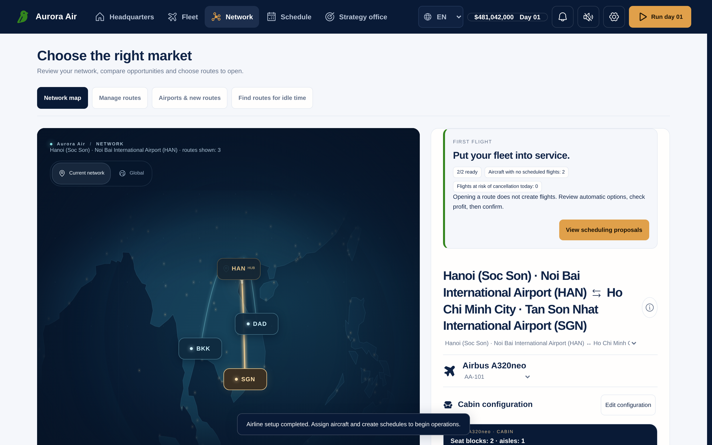
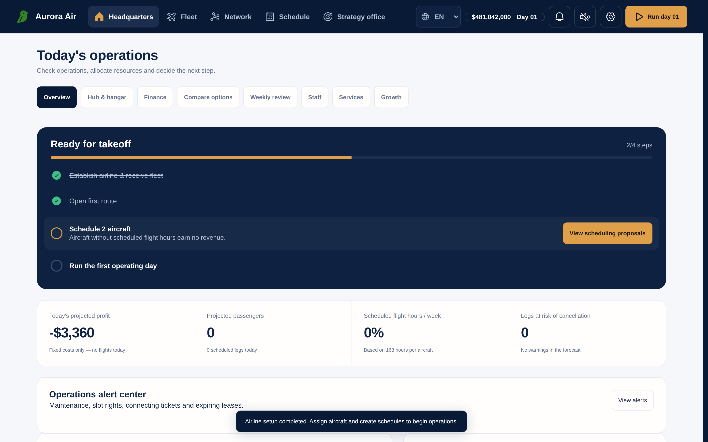

# JETRISE

JETRISE is a single-player airline-management game that runs entirely in the browser. Found an airline, buy and configure aircraft, open routes, build a weekly timetable, then run the airline one day at a time and reinvest what it earns.

**[Play it on GitHub Pages](https://thangldw.github.io/jetrise/)** — no account, no install.



## What is in the game

- **Founding.** Pick a home airport from about 4,000 real airports, name the airline, choose a logo and colour, and start with $500 million and two aircraft.
- **Fleet.** Thirteen Airbus, Boeing and Embraer types to buy new, buy used or lease, each with its own cabin layout, amenities and livery.
- **Network.** Open routes from your hubs on a world map; passenger demand per airport pair is finite and shared by every flight on the route.
- **Schedule.** A repeating 168-hour weekly timetable with 15-minute departures, maintenance windows and an automatic schedule proposal you can preview before applying.
- **Operations.** Advance one day at a time: flights are settled, aircraft wear, faults ground planes, and the daily report separates profit from cash flow.
- **Strategy.** Optional layers you switch on when you want them: two AI rival airlines with three difficulty levels, contracts, market events, connecting passengers, airport slot rights, disruption recovery and customer loyalty.
- **Languages.** Vietnamese, English and Japanese, switchable at any time.

All prices, demand and operating costs are synthetic game values, not real airline data. The rivals are local AI, not other players. See [docs/GAMEPLAY.md](docs/GAMEPLAY.md) for the full rules.



## How it works

JETRISE is a static React site. There is no backend, account or telemetry: the simulation runs in the browser, heavier forecasts run in a Web Worker, and the career is saved in the browser's `localStorage`. The Save Manager exports and imports a career as a JSON file, which is the only way to move it between browsers or devices.

## Run it locally

Requires Node 22.

```
npm ci
npm run dev    # dev server with hot reload
npm test       # full test suite
```

## Documentation

| Document | Contents |
| --- | --- |
| [docs/GAMEPLAY.md](docs/GAMEPLAY.md) | Game rules and systems, and what is deliberately not simulated |
| [docs/ARCHITECTURE.md](docs/ARCHITECTURE.md) | Code layout, state model, save format and compatibility rules |
| [docs/DESIGN.md](docs/DESIGN.md) | Interface structure and interaction conventions |
| [docs/DEVELOPMENT.md](docs/DEVELOPMENT.md) | Setup, tests, long-run validation and publishing to GitHub Pages |
| [docs/airport-display-names/](docs/airport-display-names/) | Sources and per-field provenance for localized airport names |

## License and credits

Code is released under the [MIT License](LICENSE).

Airport data comes from [OurAirports](https://ourairports.com/data/) (public domain). Localized airport and city names are adapted from [GeoNames](https://www.geonames.org/) ([CC BY 4.0](https://creativecommons.org/licenses/by/4.0/)) and Wikidata (CC0). The world outline comes from [Natural Earth](https://www.naturalearthdata.com/) (public domain). Icons are [Phosphor Icons](https://phosphoricons.com/) (MIT).

Aircraft type names are used descriptively; JETRISE is not affiliated with or endorsed by any aircraft manufacturer or airline.
